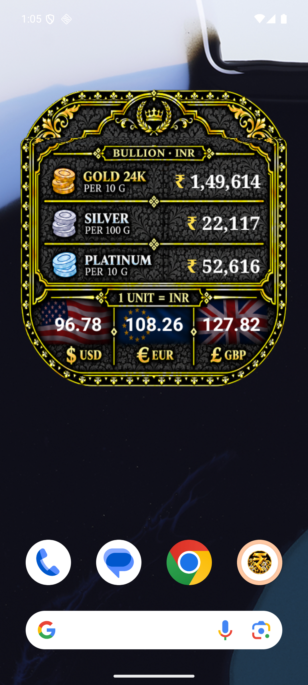

# Bullion Forex Mobile

Android application. Current version: 1.0.5.

[Download APK](https://github.com/aniruddhaKol/bullion-forex-mobile/releases/tag/v1.0.5)



## Layout

- `versions/v103`, `versions/v104`, `versions/v105`: preserved version source, resources, build scripts and signed APKs. Latest source is `versions/v105`.
- `previews/`: widget renders and screenshots grouped by version.

## Build

Requires Android SDK platform 36, build-tools 36.0.0 and a compatible JDK. Set `JAVA_HOME` locally. Signing configuration comes from environment variables: `SIGNING_KEYSTORE`, `SIGNING_ALIAS`, `SIGNING_STORE_PASSWORD` and `SIGNING_KEY_PASSWORD`. Use the original signing key for compatible updates. Keys and credentials are excluded from the repository. Run:

```powershell
./versions/v105/build.ps1
```

## Application identity

Existing versions retain `com.bullionforex.app`. The intended identifier for a future migration is `app.adc.bullionforex`; changing to it creates a separate installed app and is not an in-place upgrade. No identifier migration is performed here.

Original APKs are preserved unchanged. The existing signed APK is available from the Releases page. Third-party font and data-provider notices remain with the source.


## License

Copyright © 2026 Aniruddha DuttaChowdhury.

Original project material is licensed under the **PolyForm Noncommercial License 1.0.0**. Personal, academic, research, educational and other qualifying noncommercial uses, modifications and redistribution are permitted in accordance with its terms. Commercial uses outside those permissions require separate authorization from the copyright holder.

Anyone redistributing covered software, including within another application, must pass along the license terms or their URL and all applicable Required Notices identifying the original author, project and source repository. This license does not require publication of the modified application's source code.

For complete terms, see [LICENSE.md](LICENSE.md). Third-party software, libraries, fonts, data and artwork remain subject to their respective licenses; see [third-party notices and unresolved permissions](THIRD-PARTY-NOTICES.md).

### Redistribution attribution example

For an application derived from `bullion-forex-mobile`, accompany the distributed software with the license terms or their URL and these notices, for example in licensing documents or an attribution file:

```text
Based on: bullion-forex-mobile
Required Notice: Copyright © 2026 Aniruddha DuttaChowdhury.
Required Notice: Original Author: Aniruddha DuttaChowdhury.
Required Notice: Original Project: bullion-forex-mobile.
Required Notice: Original Source: https://github.com/aniruddhaKol/bullion-forex-mobile
License: PolyForm Noncommercial License 1.0.0
License terms: https://polyformproject.org/licenses/noncommercial/1.0.0
```

An About screen acknowledgment is encouraged. The standard license does not impose separate app-store attribution or UI-branding requirements, or require public disclosure of modified source code.
